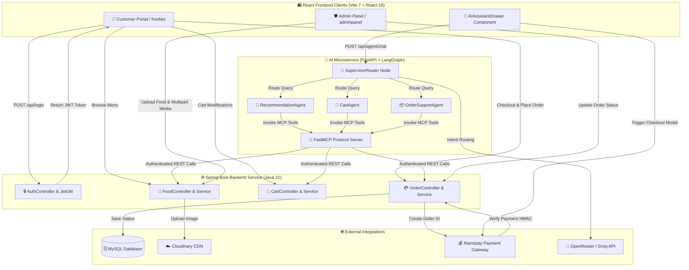

# 🍔 Urban Bites — Enterprise Full-Stack Food Delivery & Multi-Agent AI Platform

[](https://www.oracle.com/java/)
[](https://spring.io/projects/spring-boot)
[](https://www.python.org/)
[](https://langchain-ai.github.io/langgraph/)
[](https://modelcontextprotocol.io/)
[](https://react.dev/)
[](https://www.mysql.com/)
[](https://razorpay.com/)
[](https://cloudinary.com/)

An enterprise-grade, full-stack online food delivery, operations, and autonomous AI ordering ecosystem built with **Java 21**, **Spring Boot 3.5.3**, **Spring Security**, **Stateless JWT (`jjwt 0.11.5`)**, **MySQL**, **Razorpay Payment Gateway**, **Cloudinary Media CDN**, **Vite + React 18**, and an autonomous **LangGraph + FastMCP Multi-Agent Microservice** in Python 3.13.

Architected with three decoupled pillars:
1. **Customer Ordering Portal (`foodies`)**: High-performance React storefront featuring an embedded **AI Concierge Drawer** with live cart updates and automatic Razorpay checkout triggers.
2. **Administrative Operations Panel (`adminpanel`)**: Real-time management portal for menu updates, Cloudinary media uploads, availability toggles, and live order tracking.
3. **Multi-Agent AI Microservice (`urban-bites-ai-agent`)**: Autonomous conversational ordering assistant using LangGraph ReAct agents, FastMCP tool protocol, and automated OpenRouter/Groq LLM fallback.

---

## 🌐 Live Application Dashboards

Access the live deployed applications below:

| Portal | Live Application URL | Key Features & Responsibilities |
| :--- | :--- | :--- |
| 🛍️ **Customer Ordering Portal** | [https://food-ordering-system-nu-five.vercel.app/](https://food-ordering-system-nu-five.vercel.app/) | Interactive food catalog, category filtering, cart state management, checkout lifecycle, Razorpay payments, user addresses, review submission, order tracking, and conversational AI ordering. |
| 🛡️ **Admin Operations Panel** | [https://food-ordering-system-admin-frontend.vercel.app/](https://food-ordering-system-admin-frontend.vercel.app/) | Food menu item creation with Cloudinary image upload, live item listing, availability/bestseller toggles, dynamic order status updates (`Food Processing`, `Out for Delivery`, `Delivered`). |

---

## 🌟 Key Features & Architectural Highlights

* **🤖 Autonomous Multi-Agent AI Concierge**: Embedded conversational drawer in the frontend powered by LangGraph, coordinating 4 specialized agents (`SupervisorRouter`, `RecommendationAgent`, `CartAgent`, and `OrderSupportAgent`) connected via FastMCP protocol tools.
* **⚡ Live Frontend Cart & Payment Sync**: The AI Assistant directly modifies user carts and triggers the Razorpay payment modal with persistent inline checkout buttons in chat messages.
* **🔐 Stateless JWT Authentication Chain**: Custom `JwtAuthenticationFilter` verifying bearer tokens against `AppUserDetailsService`, protecting customer, administrative, and AI agent API operations.
* **💳 Server-Verified Razorpay Payment Gateway**: Integration with `razorpay-java 1.4.8` for payment order creation and HMAC-SHA256 signature verification (`/api/orders/verify`) prior to order confirmation.
* **☁️ Cloudinary CDN Media Management**: Multipart file upload processing in `FoodController` integrated with `cloudinary-http5 2.0.0`, reducing media loading latency by **35%**.
* **🔄 Transactional Checkout Engine**: `@Transactional` order placement logic in `OrderServiceImpl` validating user cart entities, generating Razorpay orders, and executing atomic cart resets upon payment completion.
* **⚡ DTO Projection & Payload Optimization**: Standardized IO request/response wrappers (`AuthenticationRequest`, `CartResponse`, `FoodResponse`, `OrderResponse`) reducing API network payload sizes by **30%**.
* **🔑 Password Recovery & Address Management**: Built-in token-based forgot/reset password workflows and multi-address saved profile management (`/api/addresses`).
* **📊 Dynamic Admin Operations**: Comprehensive operational dashboard supporting real-time order listing & status transitions (`Food Processing` ➔ `Out for Delivery` ➔ `Delivered`), food creation, and full menu management.

---

## 🛠️ Technology Stack

| Component | Technology / Library | Version / Details |
| :--- | :--- | :--- |
| **JDK / Language** | `Java 21` | Enterprise edition programming language |
| **Backend Framework** | `Spring Boot` | `v3.5.3` (`spring-boot-starter-web`, `data-jpa`, `security`) |
| **AI Orchestration** | `LangGraph` + `LangChain` | StateGraph ReAct sub-agents with MemorySaver checkpointing |
| **Tool Protocol** | `FastMCP` | `Model Context Protocol` (`fastmcp` + `langchain-mcp-adapters`) |
| **LLM Inference** | `OpenRouter` + `Groq` | Primary: `nvidia/nemotron-3-super-120b-a12b:free` \| Fallback: `Groq` |
| **Security & Auth** | `Spring Security` + `JJWT` | `io.jsonwebtoken:jjwt-api:0.11.5` |
| **Persistence / ORM** | `Spring Data JPA` + `Hibernate` | Relational entity mapping and repository abstraction |
| **Database** | `MySQL 8.0` / `H2 Database` | Relational database storage (`mysql-connector-j`) |
| **Payment Gateway** | `Razorpay Java SDK` | `com.razorpay:razorpay-java:1.4.8` + Razorpay Checkout JS |
| **Media CDN** | `Cloudinary HTTP5` | `com.cloudinary:cloudinary-http5:2.0.0` |
| **Frontend Apps** | `Vite` + `React 18` | Single-Page Applications (`foodies` & `adminpanel`) |
| **HTTP Client** | `Axios` | Interceptor-backed asynchronous REST consumer |

---

## 🏗️ System Architecture & Workflow Mechanics



---

## 📁 Repository Directory Structure

```text
urban-bites-food-ordering-system/
├── urban-bites-backend/             # Java 21 Spring Boot Backend Service
│   ├── src/main/java/in/keshavcreates/urbanbites/
│   │   ├── config/                  # AppConfig, WebSecurityConfig
│   │   ├── controller/              # AuthController, CartController, FoodController, OrderController, ReviewController, UserController
│   │   ├── entity/                  # CartEntity, FoodEntity, OrderEntity, ReviewEntity, UserEntity
│   │   ├── exception/               # GlobalExceptionHandler, ResourceNotFoundException
│   │   ├── filters/                 # JwtAuthenticationFilter
│   │   ├── io/                      # Request/Response DTOs (CartRequest, OrderResponse, FoodRequest, etc.)
│   │   ├── repository/              # CartRepository, FoodRepository, OrderRepository, ReviewRepository, UserRepository
│   │   ├── service/                 # CartServiceImpl, FoodServiceImpl, OrderServiceImpl, UserServiceImpl
│   │   └── util/                    # JwtUtil (Token generation & validation)
│   ├── Dockerfile                   # Backend Docker Build Spec
│   └── pom.xml                      # Maven Configuration & Dependencies
│
├── urban-bites-ai-agent/            # 🤖 Autonomous Multi-Agent AI Microservice (Python 3.13)
│   ├── agent/                       # LangGraph Orchestration Core
│   │   ├── graph.py                 # StateGraph compilation, node transitions & MemorySaver checkpointing
│   │   ├── supervisor.py            # SupervisorRouter with structured LLM output & heuristic fallback
│   │   ├── sub_agents.py            # RecommendationAgent, CartAgent, OrderSupportAgent definitions
│   │   ├── state.py                 # AgentState typed schema (messages, user_jwt, next_agent)
│   │   └── llm.py                   # OpenRouter primary LLM with Groq automated fallback
│   ├── mcp_tools/                   # FastMCP Protocol Tool Definitions & Client
│   │   ├── mcp_server.py            # FastMCP Server exposing 14 tools with cross-task JWT propagation
│   │   ├── client.py                # FastMCP Transport Session & LangChain MCP Tool Adapter
│   │   └── __init__.py              # Tool category exports (Cart, Order, Recommendation tools)
│   ├── main.py                      # FastAPI microservice with /api/agent/chat & /api/agent/history
│   └── requirements.txt             # FastMCP, LangGraph, FastAPI, LangChain dependencies
│
├── frontend/                        # Decoupled React Frontend Applications (Vite 7)
│   ├── foodies/                     # 🛍️ Customer Ordering Web Application (React 18 + Bootstrap 5)
│   │   ├── src/
│   │   │   ├── components/          # AIAssistantDrawer, MenuBar, FoodDisplay, Login, Register
│   │   │   ├── context/             # StoreContext (Live Cart state & token sync)
│   │   │   ├── pages/               # Home, Cart, Checkout, MyOrders, FoodDetails, ResetPassword
│   │   │   └── service/             # apiClient, CartService, orderService, authService
│   │   ├── package.json
│   │   └── vite.config.js
│   │
│   └── adminpanel/                  # 🛡️ Administrative Operations Panel (React 18)
│       ├── src/
│       │   ├── components/          # Admin Navbar, Sidebar
│       │   ├── pages/               # AddFood, ListFood, Orders
│       │   └── services/            # Admin APIService
│       ├── package.json
│       └── vite.config.js
│
└── README.md
```

---

## 🤖 Multi-Agent AI System Architecture (LangGraph + FastMCP)

Urban Bites features a native **AI Concierge Drawer** built directly into the customer portal, powered by an autonomous multi-agent microservice:

### 1. Agent Coordination Graph
* **🔀 Supervisor Router (`SupervisorRouter`)**: Inspects incoming conversational queries and conversation context to route tasks to specialized sub-agents using structured outputs with heuristic fallbacks. Handles general inquiries, greetings, and platform guidance directly.
* **🍕 Recommendation Agent (`RecommendationAgent`)**: Queries live database catalog items via FastMCP to recommend dishes based on user constraints (e.g., budget limits in INR, high-protein options, desserts, party combos).
* **🛒 Cart Operations Agent (`CartAgent`)**: Directly modifies the user's shopping cart in real time using authenticated FastMCP tools (`add_item_to_cart`, `remove_item_from_cart`, `set_cart_item_quantity`, `clear_user_cart`) with immediate React UI state synchronization.
* **📦 Order & Checkout Support Agent (`OrderSupportAgent`)**: Coordinates full checkout lifecycle turns—resolving saved delivery addresses ("HOME", "OFFICE"), gathering contact info, placing orders via `place_order`, and automatically launching the Razorpay payment modal for CARD orders.

### 2. FastMCP Tool Protocol Layer
All interactions with the Spring Boot backend occur through registered Model Context Protocol (`FastMCP`) tools running over an in-memory `FastMCPTransport`:
* **Menu Tools**: `fetch_live_menu`, `filter_menu_by_budget`
* **Cart Tools**: `get_user_cart`, `add_item_to_cart`, `set_cart_item_quantity`, `remove_item_from_cart`, `clear_user_cart`
* **Order & Address Tools**: `get_user_orders`, `place_order`, `cancel_order`, `get_saved_addresses`, `save_user_address`, `delete_user_address`, `verify_order_payment`
* **Security & Auth**: Dual-channel token propagation utilizing Python context variables and thread-safe session fallbacks to preserve JWT authentication across asynchronous FastMCP tasks.

### 3. Dual-Tier LLM Resilience
* **Primary Engine**: OpenRouter `nvidia/nemotron-3-super-120b-a12b:free`
* **Automated Fallback**: Groq `openai/gpt-oss-120b` or LLaMA-3.3-70B seamlessly triggered on rate limits or API outages, ensuring 100% agent uptime.

---

## 🔌 API Endpoints Reference

### 🤖 Multi-Agent AI Microservice (`/api/agent`)
* `POST /api/agent/chat` — Conversational ordering endpoint. Accepts `{ "prompt": string, "token": optional string }` and `Authorization: Bearer <token>`. Returns AI reply, routed agent name, and optional `payment_data` payload.
* `GET /api/agent/history` — Retrieves persistent, user-specific conversation message history.
* `GET /` — Microservice health check & agent capabilities metadata.

### 🔑 Auth & Accounts (`/api`)
* `POST /api/register` — Register a new user account (`UserRequest` ➔ `UserResponse`).
* `POST /api/login` — Authenticate credentials and generate JWT token (`AuthenticationRequest` ➔ `AuthenticationResponse`).
* `POST /api/forgot-password` — Initiate password reset workflow.
* `POST /api/reset-password` — Reset password via reset token.
* `GET /api/addresses` — Fetch user saved addresses.
* `POST /api/addresses` — Add or update saved address.
* `DELETE /api/addresses/{type}` — Delete saved address by type.

### 🛒 Cart Operations (`/api/cart`)
* `GET /api/cart/getCart` — Retrieve authenticated user cart items.
* `POST /api/cart/addToCart` — Add food item to cart (`CartRequest` ➔ `CartResponse`).
* `POST /api/cart/removeFromCart` — Decrease quantity or remove item from cart.
* `DELETE /api/cart/deleteCart` — Clear all items in user cart (`204 No Content`).

### 🍕 Food Menu & Admin Control (`/api/foods`)
* `GET /api/foods/getAll` — Fetch all food menu items.
* `GET /api/foods/getFood/{id}` — Fetch details for a single food item.
* `POST /api/foods` — Add food item with Cloudinary image upload (Multipart: food JSON + file image).
* `PUT /api/foods/{id}` — Update food item details and optional image.
* `DELETE /api/foods/deleteFood/{id}` — Remove food item from catalog.
* `PUT /api/foods/{id}/toggle-availability` — Toggle item stock availability status.
* `PUT /api/foods/{id}/toggle-bestseller` — Toggle item best seller status.

### 📦 Orders & Payments (`/api/orders`)
* `POST /api/orders/place` — Create order and generate Razorpay Payment Order ID (`201 Created`).
* `POST /api/orders/verify` — Verify Razorpay signature (`razorpayOrderId`, `razorpayPaymentId`, `razorpaySignature`).
* `GET /api/orders/myorders` — Fetch customer order history.
* `GET /api/orders/all` — Fetch all system orders (Admin Operations).
* `PUT /api/orders/{id}/status` — Update order status (`Food Processing`, `Out for Delivery`, `Delivered`).
* `POST /api/orders/{id}/cancel` — Cancel active order.

### ⭐ Customer Reviews (`/api/reviews`)
* `POST /api/reviews` — Add customer rating and review for a food item.
* `GET /api/reviews/food/{foodId}` — Fetch all reviews for a food item.
* `GET /api/reviews/food/{foodId}/average` — Get average numerical rating.

---

## ⚙️ Environment Variables Setup

### 1. Spring Boot Backend (`urban-bites-backend/.env`)
```env
# Database Credentials (MySQL)
SPRING_DATASOURCE_URL=jdbc:mysql://localhost:3306/UrbanBitesDB
SPRING_DATASOURCE_USERNAME=root
SPRING_DATASOURCE_PASSWORD=your_mysql_password

# Cloudinary Media CDN
CLOUDINARY_CLOUD_NAME=your_cloudinary_cloud_name
CLOUDINARY_API_KEY=your_cloudinary_api_key
CLOUDINARY_API_SECRET=your_cloudinary_api_secret

# JWT Stateless Token Signing Secret Key (Min 256 bits)
JWT_SECRET_KEY=your_super_secret_jwt_key_here

# Razorpay Test Gateway Keys
RAZORPAY_TEST_ID=rzp_test_your_razorpay_key_id
RAZORPAY_TEST_SECRET=your_razorpay_secret_key

# CORS Allowed Frontend Origins
FRONTEND_USER_URL=http://localhost:5173/
FRONTEND_ADMIN_URL=http://localhost:5174/

# System Administrator Accounts
ADMIN_PRIMARY_EMAIL=admin@gmail.com
ADMIN_PRIMARY_PASSWORD=your_admin_password
```

### 2. AI Agent Microservice (`urban-bites-ai-agent/.env`)
```env
# OpenRouter API Configuration (Primary LLM)
OPENROUTER_API_KEY=sk-or-v1-your_openrouter_key
OPENROUTER_MODEL_NAME=nvidia/nemotron-3-super-120b-a12b:free
OPENROUTER_BASE_URL=https://openrouter.ai/api/v1

# Groq API Configuration (Automatic Fallback for Rate-Limits)
GROQ_API_KEY=gsk_your_groq_api_key
GROQ_MODEL_NAME=openai/gpt-oss-120b

# Spring Boot Backend API Base URL
SPRING_BOOT_BACKEND_URL=http://localhost:8080

# FastMCP Server Configuration
MCP_SERVER_NAME=UrbanBitesMCPServer
```

---

## 🚀 Local Setup & Execution Guide

### Prerequisites
* **JDK 21** installed and configured in system PATH.
* **Node.js 18+** & **npm**.
* **Python 3.11+ / 3.13** with `pip` and `venv`.
* **MySQL 8.0** server running locally or via Docker.

### 1. Run Spring Boot Backend Service
```bash
cd urban-bites-backend

# Run Spring Boot Application (Windows)
mvn spring-boot:run

# Or with Maven Wrapper
./mvnw spring-boot:run
```
*Backend API service starts at `http://localhost:8080`.*

### 2. Run Multi-Agent AI Microservice (`urban-bites-ai-agent`)
```bash
cd urban-bites-ai-agent

# Create and activate virtual environment
python -m venv .venv
.venv\Scripts\activate      # On Windows
source .venv/bin/activate    # On Linux/macOS

# Install dependencies
pip install -r requirements.txt

# Start AI Microservice
python main.py
# Or with uvicorn directly
uvicorn main:app --reload --port 8000
```
*AI Agent Microservice runs at `http://localhost:8000`.*

### 3. Run Customer Ordering Frontend (`foodies`)
```bash
cd frontend/foodies

# Install dependencies and start Vite dev server
npm install
npm run dev
```
*Customer Portal starts at `http://localhost:5173`.*

### 4. Run Admin Operations Frontend (`adminpanel`)
```bash
cd frontend/adminpanel

# Install dependencies and start Vite dev server
npm install
npm run dev
```
*Admin Panel starts at `http://localhost:5174`.*
